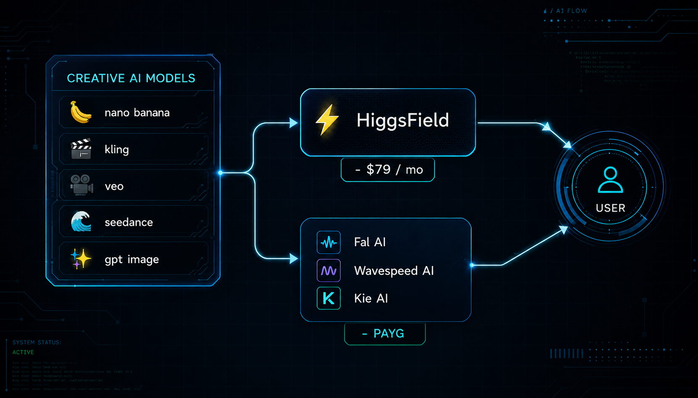

# generator-skill

<div align="center">
  
  <p><strong>Arckhé AI</strong></p>
</div>


**ê°Å¸â€¡Â§ê°Å¸â€¡Â· [PortuguêƒÂªs](README.md) ê‚· ê°Å¸â€¡Âºê°Å¸â€¡Â¸ [English](README.en.md) ê‚· ê°Å¸â€¡Âªê°Å¸â€¡Â¸ [EspaêƒÂ±ol](README.es.md)**


## ê°Å¸â€œâ€“ Guia de uso

Guia completo (landing + passo a passo): **https://linnoff88-dev.github.io/

Duas versêƒÂµes da skill `/generate` ê¢â‚¬â€ um comando para o agente gerar imagens e
vêƒÂ­deos sob demanda, escolher a rota de menor custo, controlar gasto e salvar
tudo num lugar sêƒÂ³.

SêƒÂ£o duas porque a decisêƒÂ£o mais importante da skill ê¢â‚¬â€ **qual êƒÂ© a rota mais
barata** ê¢â‚¬â€ tem respostas opostas dependendo da mêƒÂ¡quina.

## Qual usar

| | [`generate-local/`](generate-local/) | [`generate-api/`](generate-api/) |
|---|---|---|
| **Para** | mêƒÂ¡quina com modelo rodando nela | qualquer mêƒÂ¡quina, tudo via API |
| **Rota mais barata** | local, **$0** (flux2-klein na GPU) | modelo barato pago, ~$0,02 |
| **Modelo de cobranêƒÂ§a** | hardware jêƒÂ¡ pago, custo marginal zero | pay-as-you-go por chamada |
| **Rota paga** | exceêƒÂ§êƒÂ£o ê¢â‚¬â€ duas razêƒÂµes sêƒÂ³ | êƒÂ© o êƒÂºnico caminho |
| **Imagem padrêƒÂ£o** | flux2-klein local, ~6 s | modelo barato de imagem |
| **Imagem com texto legêƒÂ­vel** | fal.ai, pago (local erra letra) | modelo top, pago |
| **VêƒÂ­deo padrêƒÂ£o** | render 2.5D local (`pixflow-motion`), $0 | modelo generativo, $0,20ê¢â‚¬â€œ0,35/s |
| **PortêƒÂ£o de custo** | existe, quase nunca dispara | dispara em toda execuêƒÂ§êƒÂ£o |
| **"Rascunhe barato, finalize caro"** | sem sentido ê¢â‚¬â€ êƒÂ© o mesmo modelo | êƒÂ© a regra que mais economiza |
| **Livro-caixa** | existe, quase sempre zerado | êƒÂ© o coraêƒÂ§êƒÂ£o da skill |
| **Depende de** | servidor `ARCKHê‰img` no ar (porta 8000) | `FAL_KEY` + `KIE_API_KEY` num `.env` |
| **Teto de aviso** | $20/mêƒÂªs | configurêƒÂ¡vel, padrêƒÂ£o $50/mêƒÂªs |

O que **nêƒÂ£o** muda entre as duas, porque êƒÂ© o que faz o sistema durar: uma receita
Markdown por modelo, biblioteca plana, log JSON ao lado de cada arquivo,
referêƒÂªncia real em vez de descrita, e as regras dentro do `SKILL.md` ê¢â‚¬â€ que o
agente relêƒÂª a cada uso.

## Os cinco passos

O fluxo êƒÂ© o mesmo nas duas versêƒÂµes; muda sêƒÂ³ para onde o passo 1 aponta.

1. **Roteia para o modelo mais econêƒÂ´mico** que dêƒÂ¡ conta da tarefa, e lêƒÂª a receita
   daquele modelo antes de chamar.
2. **Usa referêƒÂªncias reais** ê¢â‚¬â€ logotipos, rostos, estilo ê¢â‚¬â€ carregadas de `refs/`.
   Descrever um logo em palavras devolve logo errado toda vez.
3. **Gera** imagem ou vêƒÂ­deo. Se o modelo for assêƒÂ­ncrono, consulta o status e
   baixa na hora, porque URL de resultado expira.
4. **Salva tudo numa pasta êƒÂºnica e plana**, sem subpastas, com nome previsêƒÂ­vel.
5. **Registra prompt, modelo, parêƒÂ¢metros e custo** num JSON ao lado do arquivo.

## Por que agregador, e por que pay-as-you-go



Os mesmos modelos sêƒÂ£o alcanêƒÂ§êƒÂ¡veis por caminhos com contas muito diferentes.
Plataformas de **assinatura** cobram um valor fixo por mêƒÂªs ê¢â‚¬â€ previsêƒÂ­vel, e boa
quando o uso êƒÂ© alto e constante. Agregadores **pay-as-you-go** (fal.ai, Kie AI)
cobram por chamada, com uma chave e uma fatura sêƒÂ³ para dezenas de modelos.

A versêƒÂ£o `generate-api` assume pay-as-you-go, por trêƒÂªs razêƒÂµes: comeêƒÂ§a em zero,
o custo êƒÂ© atribuêƒÂ­vel a cada geraêƒÂ§êƒÂ£o (êƒÂ© o que alimenta o livro-caixa), e nêƒÂ£o se
paga mensalidade em mêƒÂªs parado. Se o volume subir a ponto de a assinatura sair
mais barata, o cêƒÂ¡lculo êƒÂ© simples ê¢â‚¬â€ some o mêƒÂªs no `--saldo` e compare.

Na versêƒÂ£o `generate-local` a discussêƒÂ£o nêƒÂ£o existe: a GPU jêƒÂ¡ estêƒÂ¡ paga, e a rota
paga sêƒÂ³ entra nas duas exceêƒÂ§êƒÂµes documentadas.

## Instalar

```bash
cp -r generate-local ~/.claude/skills/generate               # mêƒÂ¡quina com GPU
cp -r generate-api  <workspace>/.claude/skills/generate      # mêƒÂ¡quina sem modelo local
```

As duas declaram `name: generate`. Instale **uma** por workspace, ou renomeie.

## DocumentaêƒÂ§êƒÂ£o

- [`generate-local/README.md`](generate-local/README.md) e
  [`generate-api/README.md`](generate-api/README.md) ê¢â‚¬â€ cada versêƒÂ£o em detalhe.
- [`doc/guia-skill-generate-ptbr.md`](doc/guia-skill-generate-ptbr.md) ê¢â‚¬â€ guia
  têƒÂ©cnico traduzido: autenticaêƒÂ§êƒÂ£o por provider, padrêƒÂ£o assêƒÂ­ncrono, tabela de
  modelos, faixas de custo.
- [`doc/analise-generate-skill-guide.md`](doc/analise-generate-skill-guide.md) ê¢â‚¬â€
  anêƒÂ¡lise do material original: o que ele acerta e o que faltava (orêƒÂ§amento
  acumulado, preêƒÂ§o versionado, retomada de job assêƒÂ­ncrono ê¢â‚¬â€ os trêƒÂªs estêƒÂ£o
  implementados aqui).

## Aviso que vale para as duas

IDs de modelo, preêƒÂ§os e endpoints mudam com frequêƒÂªncia. Tudo que nêƒÂ£o foi
confirmado por uma chamada real estêƒÂ¡ marcado **NêƒÆ’O VERIFICADO** nas receitas.
Confirme na documentaêƒÂ§êƒÂ£o atual do provider antes de usar para valer.

---

<div align="center">
  
  <p><strong>Arckhé AI</strong></p>
</div>